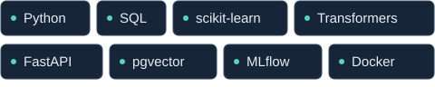

Sou **Cientista de Dados**, com atuação em NLP e busca semântica na VERT e doutorado em Genética com foco em bioinformática. Desenvolvo e avalio soluções para transformar textos e dados em informação útil, conectando experimentação científica e aplicações práticas.

[**LinkedIn ↗**](https://www.linkedin.com/in/carlos-andr%C3%A9-ab702111a/) · [**Projetos públicos ↓**](#projetos-em-destaque)

## Tecnologias

No trabalho: classificação de texto com BERTimbau e modelos clássicos, embeddings, avaliação de ranking, PostgreSQL/pgvector e integração com SAS. Nos projetos públicos abaixo: experimentação com MLflow, APIs e execução local com Docker.

## Projetos em destaque

### [Review Triage PT ↗](https://github.com/andresanto5/review-triage-pt)

**Do texto à fila de revisão humana.** Classificação de avaliações em português usando TF-IDF e regressão logística, com separação temporal e limiar escolhido na validação.

| Evidência | Entrega |
|---|---|
| **Macro-F1 0,9247** em 18.546 avaliações históricas de teste; referência majoritária: 0,4166 | API FastAPI, três experimentos registrados no MLflow e oito testes automatizados aprovados |

As notas 1/2 são um proxy de avaliação negativa. Dados de 2018, com limitações de curadoria documentadas; o resultado não representa desempenho em produção.

**Python · scikit-learn · MLflow · FastAPI · Docker**

[Resultados e limitações](https://github.com/andresanto5/review-triage-pt/blob/main/reports/INTERPRETACAO.md) · [Como executar](https://github.com/andresanto5/review-triage-pt#executar-a-demonstra%C3%A7%C3%A3o)

### [Book Review Agentic Analytics ↗](https://github.com/andresanto5/book-review-agentic-analytics)

**Consultas estruturadas e busca semântica sobre avaliações de livros.** Prova de conceito desenvolvida para um desafio técnico, com orquestração LangGraph, ferramentas MCP controladas e PostgreSQL/pgvector.

O projeto integra Amazon Bedrock para geração de respostas e inclui uma demonstração local sem chamadas pagas, com geração final simulada e identificada. A experiência com AWS neste projeto é de integração em uma prova de conceito.

**Python · LangGraph · MCP · FastAPI · PostgreSQL/pgvector · Amazon Bedrock**

[Arquitetura e demonstração](https://github.com/andresanto5/book-review-agentic-analytics#readme)

## Como trabalho

- **Formulo a pergunta:** defino alvo, referência de comparação e critérios de avaliação.
- **Investigo os resultados:** analiso erros, desbalanceamento e limites dos dados.
- **Conecto modelo e aplicação:** organizo código reproduzível, APIs e documentação técnica.

## Ciência e pesquisa

Doutor em Genética pela **UFPE**, com foco em bioinformática, e experiência de pós-doutorado no Brasil e na Itália. Também atuo como **professor/pesquisador adjunto no CESMAC**. Minha trajetória inclui biologia de sistemas, modelagem e dinâmica molecular e orienta o cuidado com hipóteses, desenho experimental e interpretação dos resultados.

## Sobre este portfólio

Boa parte do meu desenvolvimento profissional acontece em repositórios da empresa. Aqui reúno projetos públicos e trabalhos de aprendizado; o gráfico de contribuições representa apenas parte dessa atividade.

---

**Vamos conversar sobre dados e NLP:** [LinkedIn](https://www.linkedin.com/in/carlos-andr%C3%A9-ab702111a/)
